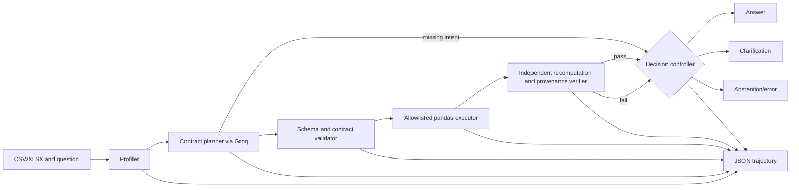

# DataProof architecture

The model proposes structured JSON and never executes arbitrary code. The executor allows only count, sum, mean, median, minimum, maximum and distinct-count operations, up to four filters, and at most two grouping columns. The verifier recomputes the requested result and records the source columns and row count. Each state transition is timestamped.

## Gap mapping

| Gap | Component | Switch |
|---|---|---|
| Semantic compliance | JSON contract plus validator | `Config(contract=False)` changes planner instruction |
| Evidence-backed acceptance | recomputation verifier | `Config(verifier=False)` |
| Unsafe action under ambiguity | clarification/abstention controller | `Config(abstention=False)` |

The switches are exposed through the experiment runner. Safety validation remains enabled when the contract prompt is ablated so an ablation cannot make the local executor run arbitrary operations.
